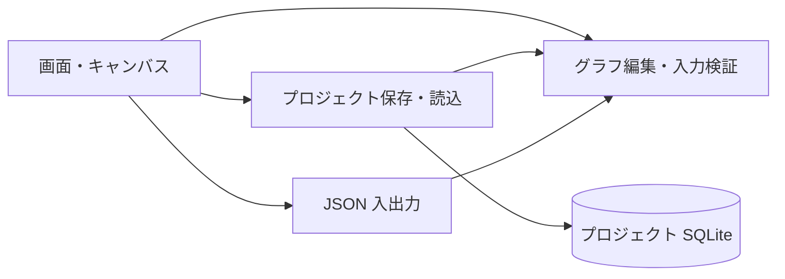

# Light Bringer デザインドキュメント

Light Bringer は、ドメイン知識をノードと関係として記録し、編集・可視化するデスクトップアプリケーションです。初版は macOS の単一ユーザーを対象とし、Rust と gpui-kit で画面を構築します。プロジェクトはローカルの SQLite に保存し、オフラインで作業できます。

2026年11月19日時点の設計です。実装担当者が、グラフの作成から保存・再表示までを一貫して実装するための判断をまとめます。

本書は単体 SQLite で保存する初版を扱います。標準プロジェクト形式を `.lbproj` に移行する設計は、[プロジェクトファイル設計](project-file.md) に記載します。

## 目次

- [1. 初版の対象](#1-初版の対象)
- [2. グラフの作成と編集](#2-グラフの作成と編集)
- [3. データモデル](#3-データモデル)
- [4. アプリケーション構成](#4-アプリケーション構成)
- [5. 保存とファイル交換](#5-保存とファイル交換)
- [6. グラフの可視化](#6-グラフの可視化)
- [7. 実装順序と検証](#7-実装順序と検証)

## 1. 初版の対象

利用者が仕様書や業務上の会話から概念と関係を取り出し、後から根拠を確認できるグラフとして整理します。

| 操作 | 初版で提供する機能 |
| --- | --- |
| プロジェクト | 保存先を選んで新規作成し、保存済みのプロジェクトを開く |
| グラフ編集 | ノードと向きのある関係を追加・変更・削除する |
| 可視化 | グラフを表示し、選択・ドラッグ・パン・ズームで操作する |
| 保存 | グラフとノードの配置を保存し、次回開いたときに復元する |
| ファイル交換 | アプリの形式で JSON を書き出し、別のプロジェクトとして取り込む |

文書からの自動抽出、共同編集、同期、高度な経路探索、自動レイアウトは将来の候補です。文書からの抽出を追加する場合は、出典付きの候補を提示し、利用者が確認してから登録する流れを想定します。

## 2. グラフの作成と編集

仕様書の「注文には1件以上の注文明細が含まれる」という記述を例とします。

1. 「注文」と「注文明細」を業務概念として登録します。登録済みの概念は一覧から選びます。
2. 「注文」を始点、「注文明細」を終点に指定し、「含む」という関係を作成します。
3. 関係の補足に「1件以上」と入力し、出典に仕様書の文書名と該当節を記録します。
4. キャンバスで関係の向きとラベルを確認し、ノードの位置を調整して保存します。

```text
[注文] ── 含む ──▶ [注文明細]
```

画面は、ノード一覧、グラフキャンバス、選択項目の詳細フォームで構成します。関係の作成時は一覧またはフォームで両端を指定できるようにします。同じ名前の概念があるときは、種別や説明を見て再利用するノードを選びます。

ノード削除時は関連するエッジの件数を示し、確認後にエッジと配置も削除します。エッジの削除では、その両端のノードを参照できる状態を保ちます。

## 3. データモデル

ノードとエッジで構成する有向グラフを採用します。エッジの両端はノードの永続IDで参照します。名前の変更後も、同じIDを通じて関係をたどれます。

| データ | 必須項目 | 任意項目 |
| --- | --- | --- |
| ノード | ID、名前 | 種別、説明、出典 |
| エッジ | ID、始点ノードID、終点ノードID、関係名 | 補足、出典 |
| ノード配置 | ノードID、グラフ座標の `x` と `y` | — |

ID は作成時に発行する UUID とします。名前と関係名は前後の空白を除き、空文字をエラーにします。同名ノードを許容し、ID で識別します。同じノード間の複数の関係、循環、自己ループを表現できます。

補足と出典はテキストとして保存します。たとえば「1件以上」は業務知識として記録する情報であり、個々の注文を検証する実行ルールの導入は別途検討します。

ノードの配置は、業務上の関係とは独立して管理します。ドラッグで更新するのは配置です。パンとズームは作業中の表示状態として扱います。

## 4. アプリケーション構成

単一の Rust プロセスで画面、編集処理、永続化を実行します。画面は編集操作を Rust の関数として呼び出します。



| モジュール | 責務 |
| --- | --- |
| `ui` | gpui-kit の画面、入力イベント、選択・表示状態、保存状態の表示 |
| `graph` | ノードとエッジのモデル、編集操作、入力と参照の検証 |
| `storage` | `rusqlite` による SQLite の読み書き、トランザクション、スキーマ更新 |
| `exchange` | `serde` と `serde_json` による交換形式の読み書き |

### 技術選定の理由

- **gpui-kit と GPUI**。フォームや一覧に gpui-kit の部品を使います。グラフは GPUI の `canvas` で描画します。座標変換、選択判定、エッジ表示はアプリ側で実装します。 [GPUI Kit の描画ガイド](https://gpui-kit.com/docs/paint/)
- **SQLite と rusqlite**。SQLite をアプリに組み込み、プロジェクトごとのファイルに保存します。`bundled` 機能を使い、配布先の SQLite に依存しない構成を取ります。Neo4j が担っていた保存を SQLite に移し、探索処理は Rust が担います。 [rusqlite の利用ガイド](https://github.com/rusqlite/rusqlite#usage)
- **グラフ探索と配置**。直接つながる関係はエッジの始点と終点から取得できます。経路探索を導入する段階で `petgraph` を採用候補とします。自動配置を導入する段階で `fdg-sim` を検証します。探索用の内部インデックスは永続IDと対応付けます。 [petgraph の StableGraph](https://docs.rs/petgraph/latest/petgraph/stable_graph/struct.StableGraph.html) · [fdg-sim](https://docs.rs/fdg-sim/latest/fdg_sim/)

旧 PoC は、Elm・Roc・Tauri と Neo4j を組み合わせた構成です。新構成では画面と編集処理を同じプロセスに置くため、ローカル API サーバーやデータベースサーバーの起動管理を省けます。 [旧 PoC の技術構成](tech_stack_REST_version_alpha.md)

## 5. 保存とファイル交換

### SQLite への保存

1プロジェクトの保存単位は1つの SQLite データベースです。利用者は「保存」で、編集中のグラフと配置をまとめて確定します。

| テーブル | 主な制約 |
| --- | --- |
| `nodes` | `id` を主キーとする |
| `edges` | `id` を主キーとし、`source_id` と `target_id` は `nodes.id` を参照する。両列に索引を設ける |
| `node_positions` | `node_id` を主キーとし、`nodes.id` を参照する |

接続ごとに外部キー制約を有効化します。ノード削除時は、関連エッジと配置を外部キーのカスケードで削除します。編集モデルでも同じ削除を適用し、画面と保存内容を一致させます。 [SQLite の外部キー制約](https://sqlite.org/foreignkeys.html)

同じプロジェクトを複数のウィンドウやアプリの起動から開く場合、編集できるセッションを1つに制限します。保存時は変更内容を一つのトランザクションで確定します。失敗時は保存済みの状態を維持し、編集中の変更をメモリに残します。利用者はエラーを確認して保存を再試行できます。

未保存の変更がある状態で閉じるか別のプロジェクトへ切り替える場合は、「保存」「破棄」「キャンセル」を提示します。保存を選んだ場合は、成功後に閉じるか切り替えます。

SQLite のスキーマバージョンを `user_version` で管理します。対応する旧バージョンからの更新はトランザクション内で行います。対応範囲外のバージョンは開けない旨を表示し、元のファイルを保護します。

### JSON による交換

保存済みのグラフと配置を書き出し、永続IDを引き継ぎます。形式2では `mode` が必須です。形式1を取り込むとフリーモードで開きます。 [DDDモードと形式2の設計](event-storming.md#5-データモデルと保存)

```json
{
  "format_version": 2,
  "mode": "free",
  "nodes": [
    { "id": "20c7e064-3dea-4fa3-8faf-e97db27adcc7", "name": "注文" },
    { "id": "7c2158f5-3b95-4b9f-b5be-126e6c821742", "name": "注文明細" }
  ],
  "edges": [
    {
      "id": "a74e0ddd-a089-48df-b2e4-bd0154e3a58e",
      "source_id": "20c7e064-3dea-4fa3-8faf-e97db27adcc7",
      "target_id": "7c2158f5-3b95-4b9f-b5be-126e6c821742",
      "label": "含む",
      "note": "1件以上",
      "source_reference": "注文仕様書 §2.1"
    }
  ],
  "node_positions": [
    { "node_id": "20c7e064-3dea-4fa3-8faf-e97db27adcc7", "x": 120, "y": 180 },
    { "node_id": "7c2158f5-3b95-4b9f-b5be-126e6c821742", "x": 360, "y": 180 }
  ]
}
```

ノードの任意項目は `kind`、`description`、`source_reference`、`event_storming_kind` です。エッジの任意項目は `note`、`source_reference`、`event_storming_relation` です。これらの値は文字列です。ノードごとの配置は最大1件です。

取り込み時は形式バージョン、ID の重複、エッジ端点と配置の参照先、座標の有限性、必須項目をまとめて検証します。成功したデータを、利用者が指定した新規プロジェクトに一括で保存します。エラー時は不正な項目と理由を示し、取り込み全体を中止します。既存プロジェクトへのマージは将来の候補とします。

## 6. グラフの可視化

グラフ座標から画面座標への変換に、パンの移動量とズーム倍率を使います。選択やドラッグでは逆変換を使い、表示倍率にかかわらず描画位置と操作位置を一致させます。

- エッジに矢印と関係名を描き、始点から終点への向きを示します。同じノード間に複数のエッジがあるときは線をずらします。自己ループはノードの外側に弧として描きます。
- ノードをドラッグしている間はキャンバス上の座標を更新します。ドロップ時に編集状態へ確定し、次回の保存に含めます。
- 配置を持たないノードには、空き位置を使った簡易グリッド配置を適用します。既に配置されたノードの座標は維持します。
- パンとズームの再描画は、読み込み済みのモデルと配置を使います。保存や読み込みで時間がかかる場合に備え、ファイル処理の結果を画面へ返す境界を設けます。

## 7. 実装順序と検証

1. **描画と入力の試作**。macOS 上で gpui-kit のウィンドウを起動します。日本語のノード名を入力し、2ノードと矢印1本を描画します。IME の変換確定、ズーム後の選択、ドラッグを確認します。
2. **手入力から再表示まで**。空のプロジェクトでノードと関係を作成します。保存後に開き直し、名前、関係の向き、出典、配置が復元されることを確認します。ノード削除と保存失敗も検証します。
3. **ファイル交換**。JSON で書き出し、新規プロジェクトに取り込みます。ID、関係、配置が一致することを確認します。不明な端点、重複ID、未対応バージョンで取り込みが中止されることを検証します。
4. **描画性能と配布**。想定データで初回表示時間とパン・ズーム中のフレーム時間を測定します。開発ツールのない macOS 環境で起動と保存も確認します。

### 要確認

- 最小対応 macOS と対象CPU、アプリの配布方法。
- 想定するノード数・エッジ数と、測定に使う代表データ。
- 同一プロジェクトの同時編集を防ぐファイルロックの方式。

UUID、明示保存、JSON を新規プロジェクトに取り込む方針は、この設計書で具体化した初版の判断です。操作性と対応データ規模は実装時に検証します。
