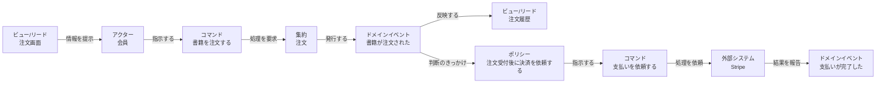

# Light Bringer のフリーモードとDDDモードの設計案

Light Bringer はプロジェクトごとに、従来のグラフ編集を行う**フリーモード**と、7種類のカードと矢印で業務の流れを表す**DDDモード**を選べます。両モードは同じグラフを表示し、編集中でも切り替えられます。

DDDモードの参考図は、書籍40ページ（PDFの58ページ目）の図4-3-1「オンライン書店のコンテキストマップ」です。今回は図の凡例にある7種類と業務の流れを対象にします。コンテキストの区画、ドメイン分類、コンテキスト間の関係は後から扱います。 [参考PDF](../つくりながら学ぶ！ドメイン駆動設計実践入門-1.0.0.pdf#page=58)

## 1. モードの選択と切り替え

「新規」でフリーモードとDDDモードを選びます。初期選択はフリーモードです。プロジェクトを開くと、ファイルに保存したモードを復元します。モードを持たない従来のファイルはフリーモードで開きます。

| モード | ノードの作成 | 関係の作成 | キャンバス |
| --- | --- | --- | --- |
| フリーモード | 名前と任意の自由記述の種別を入力する | 始点・終点と関係名を自由に指定する | 従来のノードと有向エッジを表示する |
| DDDモード | 7種類から選んでカードを作成する | 両端に合う定義済みの関係、または自由記述の関係を選ぶ | 種別ごとのカードと凡例を表示する。既存の汎用ノードは未分類として表示する |

- プロジェクトのツールバーに現在のモードを表示し、そこで切り替えます。詳細フォームに反映前の入力がある場合は、反映または取り消しを求めます。切り替えは未保存の変更として扱い、通常の「保存」で確定します。
- フリーモードからDDDモードに切り替えると、既存の汎用ノードと自由記述の関係を引き続き編集できます。利用者は任意のノードと関係に、詳細フォームからDDDの種別を割り当てられます。
- DDDモードからフリーモードに切り替えても、カードと関係の種別はデータに保持されます。フリーモードでは詳細フォームで登録済みの種別を確認できます。定義済みの関係の端点を変更する場合は、その関係が成立する端点を選ぶか、明示的に「自由記述に変更」を選びます。
- モード変更は編集操作と見た目に反映します。同じプロジェクトのノードと関係のID、内容、配置を引き継ぎます。

## 2. DDDモードのカードの種類

名前は必須です。説明と出典は任意です。名前の付け方をフォームに例示し、調査中の仮称も入力できるようにします。

| 種類 | 保存値 | 記録する内容 | 名前の例 |
| --- | --- | --- | --- |
| ビュー/リード | `view_read` | 操作や判断に使う画面、帳票、参照情報 | 注文画面、注文履歴 |
| アクター | `actor` | 操作や判断を行う人、役割、内部の主体 | 会員、書店スタッフ |
| コマンド | `command` | 実行してほしい業務上の操作 | 書籍を注文する |
| 集約 | `aggregate` | コマンドを受け、業務ルールや整合性を守る単位 | 注文 |
| ドメインイベント | `domain_event` | 業務上すでに起きた事実 | 書籍が注文された |
| ポリシー | `policy` | イベントを受けて、次に何をするか決めるルール | 注文受付後に決済を依頼する |
| 外部システム | `external_system` | 対象業務の外から処理を提供するシステム | Stripe |

ポリシーの発動条件は、既存の説明欄に記録します。たとえば「支払金額が確定している場合」と書けます。ポリシーへの矢印が判断のきっかけを示し、ポリシーから出る矢印が条件成立時の操作を示します。

## 3. DDDモードの接続ルール

矢印の向きと関係種別で、何が何につながるかを表します。定義済みの関係は、次の表にある始点と終点の組み合わせで作成できます。

| 始点 | 終点 | 保存値 | 関係の意味 |
| --- | --- | --- | --- |
| ビュー/リード | アクター | `informs` | 操作・判断に使う情報を提示する |
| アクター | コマンド | `issues` | 操作を指示する |
| コマンド | 集約 | `handled_by` | 集約に操作を要求する |
| 集約 | ドメインイベント | `emits` | 業務上の結果としてイベントを発行する |
| ドメインイベント | ポリシー | `triggers` | ルールに基づく判断のきっかけになる |
| ポリシー | コマンド | `issues` | ルールに基づいて操作を指示する |
| コマンド | 外部システム | `calls` | 外部システムに処理を依頼する |
| 外部システム | ドメインイベント | `reports` | 外部から報告された結果を業務上の事実として扱う |
| ドメインイベント | ビュー/リード | `updates` | 発生した事実を参照情報に反映する |

- 単独のカード、分岐、合流、循環を保存できます。7種類すべてを揃える必要はありません。
- 表に該当しない関連や調査中の仮のつながりには、既存の自由記述の関係を使えます。イベントストーミング用カード同士を結ぶ矢印は、定義済みの関係なら実線、自由記述なら破線で表示します。
- 同じ名前のカードを複数作れます。たとえば注文とキャンセルを横並びの行で記述する場合は、各行に「注文」集約のカードを置けます。それぞれに別のカードIDを持たせ、対応するコマンドと結果をその行でたどれるようにします。複数の経路で同じカードを共有したい場合は、既存カードを接続先に選びます。

### 記述例

オンライン書店の注文を題材にした記述例です。「書籍が注文された」を起点に、注文履歴への反映と決済の流れが分岐します。

## 4. DDDモードの編集操作

1. **カードを置く**。ノード一覧の「＋ 追加」からカード種別を選び、名前を入力して「反映」します。キャンバスの凡例とカード見出しに同じ種別名を表示します。カードは背景色と種別名の両方で識別できます。
2. **矢印を引く**。カードを選び、関係一覧の「＋ 追加」で始点を引き継ぎます。関係フォームで終点を選ぶと、両端に合う定義済みの関係を提示します。定義済みの関係の表示名には表の意味に沿った初期値を入れ、利用者は業務用語に合わせて編集できます。「自由記述」を選んだ場合は、利用者が名前を入力します。
3. **流れを整える**。ドラッグで位置を調整し、主な流れを左から右へ、分岐を上下に並べます。矢印は明示的に登録し、カードの位置から関係を推定しません。矢印のラベルを選ぶと、両端、種別、補足、出典を確認できます。
4. **編集して保存する**。カードの種別変更で既存の定義済みの関係が無効になる場合は、該当する矢印と理由を出し、編集前の状態を保ちます。利用者は該当の矢印を編集または削除した後で、種別を変更できます。カード削除と保存は既存の確認・保存操作を使います。

日本語名はカード内で折り返します。表示領域を超える名前は詳細フォームで確認できます。カードの描画、矢印の接続位置、クリック判定には同じ境界を使います。

## 5. データモデルと保存

既存の `Graph` にプロジェクトのモードとイベントストーミング用の属性を追加します。同じグラフにイベントストーミング用カードと汎用ノードを保持できます。

| 既存データ | 追加する項目 | 用途 |
| --- | --- | --- |
| `Graph` | `mode`（必須） | フリーモードを `free`、DDDモードを `ddd` として保持します。 |
| `Node` | `event_storming_kind`（任意） | 7種類のいずれかを保持します。値がない場合は汎用ノードとして扱います。 |
| `Edge` | `event_storming_relation`（任意） | 接続ルールのいずれかを保持します。値がない場合は自由記述の関係として扱います。 |

既存の自由記述 `Node.kind` は、カード種別とは別の値として保持します。たとえば既存データの `kind` に「コマンド」と入っていても、カード種別への割り当ては利用者が明示的に行います。`Edge.label` は矢印の表示名に使い、接続の検証は `event_storming_relation` に基づいて行います。関係の補足、出典、ID とカードの座標も既存の項目を使います。

- **グラフ検証**。定義済みの関係には、両モードで同じ接続ルールを適用します。`graph` にルールを置き、フォームでの候補表示と `Graph::put_edge` で共有します。`Graph::put_node` は種別を更新する前に接続済みのエッジを検証します。SQLite の読み込みと JSON の取り込みも `Graph::from_records` を通じて接続ルールを適用します。未知のモード・カード種別・関係種別や、不正な端点の組み合わせは、該当項目を示して取り込みを中止します。
- **ファイル形式**。SQLite の `user_version` と JSON の `format_version` は `2` に更新します。SQLite では `project_settings` の1行にモードを保持し、ノードとエッジのテーブルに種別の任意列を追加します。JSON にはトップレベルの必須キー `mode` を追加し、レコードの種別は値があるときだけ出力します。`.lbproj` は既存の3ファイル構成と `container_version` `1` を使います。内包する SQLite と JSON は、従来のファイルでは形式 `1`、新たな保存では形式 `2` に揃えます。読み込み時はモードと種別も照合します。
- **既存ファイル**。形式 `1` ではモードを `free` とし、カードと関係の種別を未設定として読み込みます。`.lbproj` は次回の保存時に同じスナップショットから形式 `2` の両データを作り、既存の一括置換で確定します。単体 `.sqlite` は明示的な保存時に、スキーマ更新とデータ保存を同じトランザクションで行います。旧アプリでの再編集用に元ファイルが必要な場合は、別名保存で移行します。

既存のグラフ編集と保存処理は、現行の設計書を参照してください。 [デスクトップアプリの設計](desktop-app.md) · [プロジェクトファイル設計](project-file.md)

## 6. 実装順序と確認項目

1. **モデルと保存**。モード、7種類のカード、接続ルールを実装します。形式 `1` の `.lbproj`、単体 SQLite、JSON がフリーモードで開き、既存のID、自由記述、関係、配置を復元できることを確認します。形式 `2` の再読込と JSON の往復で、保存したモードと種別を復元できることを確認します。
2. **モード選択と編集**。新規作成とツールバーにモード選択を追加します。従来のフリー編集、DDDでの接続候補、未接続カードの保存、自由記述の関係作成、不正な端点や種別変更の拒否を確認します。モードを往復し、ID、種別、関係、配置が同じであることを確認します。反映前のフォーム入力がある場合と、モードだけを変更して保存・破棄する場合も確認します。
3. **キャンバスでの確認**。DDDモードで記述例を作成し、7種類のカードと分岐を読み取れることを確認します。日本語名の折り返し、拡大・縮小時の選択、ドラッグ後の矢印、再読込後の配置を確認します。

将来は、保存済みのカードIDを参照する形で、境界づけられたコンテキストへの所属とコンテキスト間の関係を追加する想定です。今回の接続ルールは個々のカード間で完結させます。
